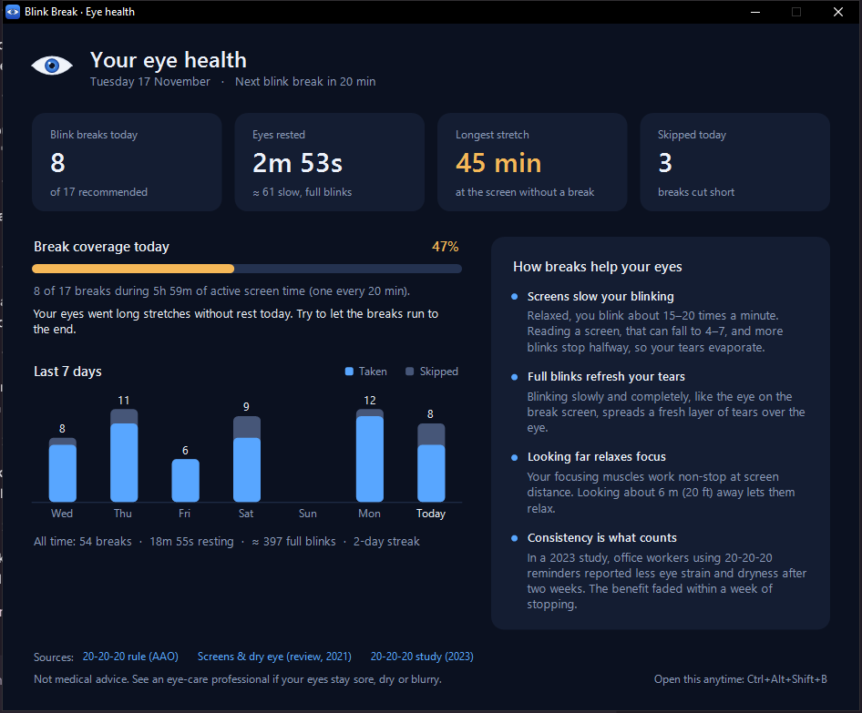

# Blink Break

A tiny, free Windows app that reminds you to rest your eyes. Every 20 minutes it covers your screen for 20 seconds with a gentle **blink break**: an animated eye blinks slowly so you can blink along with it, then you look at something far away.


## Why 20 minutes / 20 seconds?

Eye doctors recommend the **20-20-20 rule** ([American Academy of Ophthalmology](https://www.aao.org/eye-health/tips-prevention/computer-usage)): every **20 minutes**, look at something **20 feet (6 m)** away for **20 seconds**. When you stare at a screen you blink much less than normal, which dries out your eyes. A short break where you blink fully and refocus into the distance helps with that.

Both the interval and the break length can be changed from the tray menu.

## Eye health stats

Click the tray icon, or press **Ctrl+Alt+Shift+B** anywhere, to see how you're doing:



- **Today:** breaks taken, time spent resting your eyes, how many slow, full blinks you did with the guide, your longest stretch at the screen without a break, and breaks you skipped.
- **Break coverage:** breaks taken compared with how many your active screen time called for (one per interval).
- **Last 7 days:** taken and skipped breaks per day, plus all-time totals and your streak.
- **How breaks help your eyes:** a short summary of the research, with links to the sources.

Stats stay on your PC in `%APPDATA%\BlinkBreak\stats.csv`. Nothing is sent anywhere.

## Download

1. Download **`BlinkBreak.exe`** from the [latest release](../../releases/latest).
2. Move it somewhere permanent, for example `C:\Users\<you>\AppData\Local\Programs\BlinkBreak\`. It registers itself to start with Windows from wherever it is the first time it runs.
3. Double-click it. A blue eye icon appears in the system tray (next to the clock, possibly under the `^` arrow).

> **Windows SmartScreen** may warn you because the app isn't code-signed. Click **More info → Run anyway**. The full source is in this repo, and you can build it yourself (see below).

Requires Windows 10 or 11. No installer and no dependencies: it uses the .NET Framework 4.x that ships with Windows.

## Using it

- **During a break:** press **Esc** (or click "Press Esc to skip") if you really need to get out early. Esc works even when another window has keyboard focus, such as a full-screen video.
- **Left-click** the tray icon (or press **Ctrl+Alt+Shift+B**) to open your eye health stats. Hover over it to see when the next break is.
- **Right-click** the tray icon for these options:
  - Eye health stats
  - Take a blink break now
  - Pause for 1 hour
  - Break every 10 / 15 / 20 / 30 / 45 / 60 minutes
  - Break length 10 / 15 / 20 / 30 / 60 seconds
  - Start with Windows (on/off)
  - Exit

It also handles a few situations on its own:

- Covers **every monitor**.
- Restarts the timer when you **unlock** your PC or it **wakes from sleep**, so you don't get a break the moment you come back.
- Puts the break off by a minute while a **full-screen game** or **presentation mode** is running, so you don't get kicked out of the game. Full-screen video still gets breaks.

Settings are stored in `%APPDATA%\BlinkBreak\settings.ini`. A small diagnostic log (`blinkbreak.log`) in the same folder records breaks, errors, and any freezes. Please attach it if you report a bug.

Command line (also works while Blink Break is already running):

- `BlinkBreak.exe --break-now` starts a break right away.
- `BlinkBreak.exe --stats` opens the stats window.

## Uninstall

Right-click the tray icon, untick **Start with Windows**, choose **Exit**, then delete the exe and the `%APPDATA%\BlinkBreak` folder (this also deletes your stats). If you cloned the repo, you can run `uninstall.cmd` instead, which does all of that.

## Build from source

No SDK needed. The C# compiler that comes with Windows is enough:

```bat
git clone https://github.com/OniuUI/blink-break.git
cd blink-break
build.cmd        :: produces bin\BlinkBreak.exe
install.cmd      :: builds, copies to %LOCALAPPDATA%\Programs\BlinkBreak and starts it
```

The code is in [`src/`](src) (C# 5 / WinForms, about 1,700 lines). `TrayApp.cs` runs the timer and tray menu, `BreakForm.cs` is the full-screen break, `StatsForm.cs` is the stats window, and `Stats.cs` stores the history. The app draws its own icon, and `build.cmd` embeds it into the exe.

## Disclaimer

Blink Break is a reminder tool, not medical advice. If you have persistent eye strain, dryness, or headaches, see an eye-care professional.

## License

[MIT](LICENSE)
