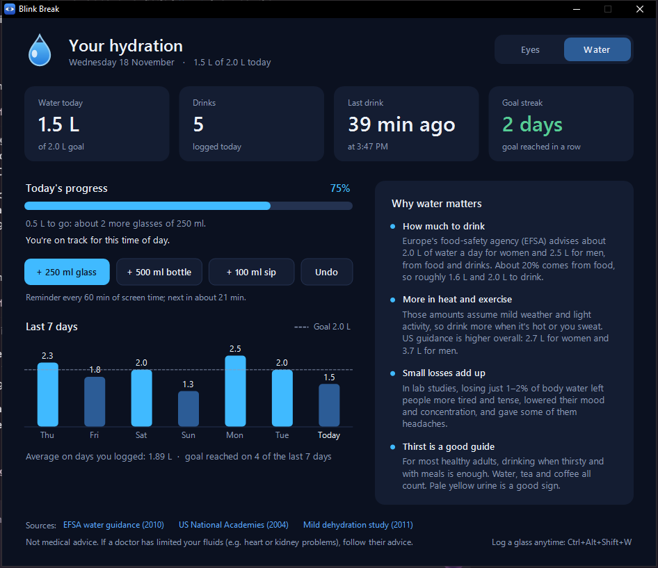
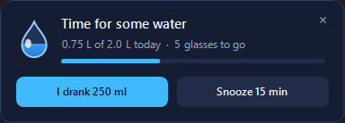

# Blink Break

A tiny, free Windows app that looks after your eyes and reminds you to drink water.

- **Blink breaks:** every 20 minutes it covers your screen for 20 seconds. An animated eye blinks slowly so you can blink along with it, then you look at something far away.
- **Water:** gentle reminders to drink, one-key logging, and a daily goal based on European and US guidelines.


## Why 20 minutes / 20 seconds?

Eye doctors recommend the **20-20-20 rule** ([American Academy of Ophthalmology](https://www.aao.org/eye-health/tips-prevention/computer-usage)): every **20 minutes**, look at something **20 feet (6 m)** away for **20 seconds**. When you stare at a screen you blink much less than normal, which dries out your eyes. A short break where you blink fully and refocus into the distance helps with that.

Both the interval and the break length can be changed from the tray menu.

## Eye health stats

Click the tray icon, or press **Ctrl+Alt+Shift+B** anywhere, to see how you're doing:


- **Today:** breaks taken, time spent resting your eyes, how many slow, full blinks you did with the guide, your longest stretch at the screen without a break, and breaks you skipped.
- **Break coverage:** breaks taken compared with how many your active screen time called for (one per interval).
- **Last 7 days:** taken and skipped breaks per day, plus all-time totals and your streak.
- **How breaks help your eyes:** a short summary of the research, with links to the sources.

Stats stay on your PC in `%APPDATA%\BlinkBreak\stats.csv`. Nothing is sent anywhere.

## Water and hydration



**How much to drink?** Europe's food-safety agency ([EFSA, 2010](https://www.efsa.europa.eu/en/press/news/nda100326)) sets adequate intakes of **2.0 L of water a day for women and 2.5 L for men**, from food and drinks together. About 20% usually comes from food, which leaves roughly **1.6 L (women) and 2.0 L (men) to drink**. The [US National Academies](https://www.nationalacademies.org/news/report-sets-dietary-intake-levels-for-water-salt-and-potassium-to-maintain-health-and-reduce-chronic-disease-risk) set higher totals (2.7 L and 3.7 L). Both assume mild weather and light activity, so drink more in heat or when you exercise. In lab studies, losing just 1–2% of body water made people more tired and lowered their mood and concentration ([Ganio et al., 2011](https://www.cambridge.org/core/journals/british-journal-of-nutrition/article/mild-dehydration-impairs-cognitive-performance-and-mood-of-men/3388AB36B8DF73E844C9AD19271A75BF)).

The default goal is **2.0 L a day**. Change it under **Water settings → Daily goal** in the tray menu.

**Logging a drink** takes one step:

- Press **Ctrl+Alt+Shift+W** anywhere to log a glass (250 ml by default).
- Click **I drank 250 ml** on a reminder.
- Choose **Log a glass of water** in the tray menu.
- Use the **+ glass / + bottle / + sip** buttons on the Water tab.

A small confirmation with an **Undo** button appears after each one.

**Reminders** pop up in the bottom-right corner after every 60 minutes of screen time since your last drink:



They never take keyboard focus. You can **snooze** one for 15 minutes or just ignore it, and they stop once you reach your goal for the day. Change the interval or turn them off under **Water settings → Remind me**. You can also change your glass size there. **Pause reminders for 1 hour** pauses both blink breaks and water reminders.

The Water tab shows today's progress and whether you're on pace, your last drink, your goal streak, a 7-day chart, and a short research summary with sources. Open it from the tray menu (**Water & hydration**) or the tab at the top of the stats window. Every drink is stored in `%APPDATA%\BlinkBreak\water.csv`.

> Not medical advice. If a doctor has limited how much you drink (for example for heart or kidney problems), follow their advice.

## Download

1. Download **`BlinkBreak.exe`** from the [latest release](../../releases/latest).
2. Move it somewhere permanent, for example `C:\Users\<you>\AppData\Local\Programs\BlinkBreak\`. It registers itself to start with Windows from wherever it is the first time it runs.
3. Double-click it. A blue eye icon appears in the system tray (next to the clock, possibly under the `^` arrow).

> **Windows SmartScreen** may warn you because the app isn't code-signed. Click **More info → Run anyway**. The full source is in this repo, and you can build it yourself (see below).

Requires Windows 10 or 11. No installer and no dependencies: it uses the .NET Framework 4.x that ships with Windows.

## Using it

- **During a break:** press **Esc** (or click "Press Esc to skip") if you really need to get out early. Esc works even when another window has keyboard focus, such as a full-screen video.
- **Left-click** the tray icon (or press **Ctrl+Alt+Shift+B**) to open your eye health stats. Hover over it to see when the next break is.
- **Right-click** the tray icon for these options:
  - Eye health stats / Water & hydration
  - Log a glass of water / Undo last drink
  - Take a blink break now
  - Pause reminders for 1 hour
  - Break every 10 / 15 / 20 / 30 / 45 / 60 minutes
  - Break length 10 / 15 / 20 / 30 / 60 seconds
  - Water settings: daily goal, glass size, reminder interval
  - Start with Windows (on/off)
  - Exit

It also handles a few situations on its own:

- Covers **every monitor**.
- Restarts the timer when you **unlock** your PC or it **wakes from sleep**, so you don't get a break the moment you come back.
- Puts the break off by a minute while a **full-screen game** or **presentation mode** is running, so you don't get kicked out of the game. Full-screen video still gets breaks.

Settings are stored in `%APPDATA%\BlinkBreak\settings.ini`. A small diagnostic log (`blinkbreak.log`) in the same folder records breaks, errors, and any freezes. Please attach it if you report a bug.

Command line (also works while Blink Break is already running):

- `BlinkBreak.exe --break-now` starts a break right away.
- `BlinkBreak.exe --stats` opens the stats window.
- `BlinkBreak.exe --water` opens the Water tab.

## Uninstall

Right-click the tray icon, untick **Start with Windows**, choose **Exit**, then delete the exe and the `%APPDATA%\BlinkBreak` folder (this also deletes your stats and water log). If you cloned the repo, you can run `uninstall.cmd` instead, which does all of that.

## Build from source

No SDK needed. The C# compiler that comes with Windows is enough:

```bat
git clone https://github.com/OniuUI/blink-break.git
cd blink-break
build.cmd        :: produces bin\BlinkBreak.exe
install.cmd      :: builds, copies to %LOCALAPPDATA%\Programs\BlinkBreak and starts it
```

The code is in [`src/`](src) (C# 5 / WinForms). `TrayApp.cs` runs the timers and tray menu, `BreakForm.cs` is the full-screen break, `StatsForm.cs` is the stats window, `WaterToast.cs` is the reminder pop-up, and `Stats.cs` / `WaterLog.cs` store the history. The app draws its own icon, and `build.cmd` embeds it into the exe.

## Disclaimer

Blink Break is a reminder tool, not medical advice. If you have persistent eye strain, dryness, or headaches, see an eye-care professional. If a doctor has given you a fluid limit, follow it instead of the water goal here.

## License

[MIT](LICENSE)
